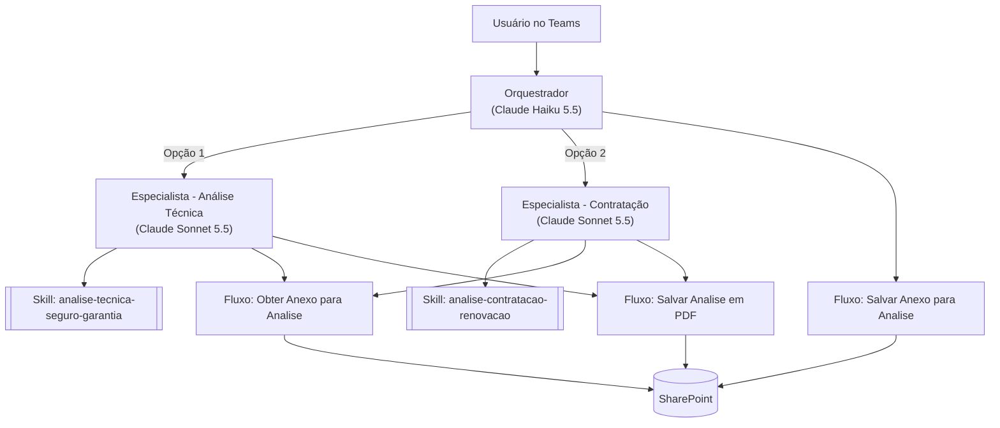

# Agente de Análise de Seguro Garantia (Microsoft Copilot Studio)

Sistema multiagente para o **Microsoft Teams**, feito no **Microsoft Copilot Studio**. Ele confere documentos de seguros corporativos e devolve um parecer técnico padronizado, que também é salvo em PDF.

Faz dois tipos de análise:

1. **Análise Técnica de Seguro Garantia**: confere a apólice, a minuta ou o endosso contra o contrato ou o aditivo. São 10 validações: partes, vínculo, vigência, LMG, coberturas, modalidade, franquia e exclusões.
2. **Análise de Processo de Contratação e Renovação**, em 6 etapas:
   1. Edital x Proposta
   2. Edital x Propostas de várias seguradoras (comparativo e ranking)
   3. Proposta V1 x Proposta V2
   4. Proposta final x Certificado x Pedido de emissão
   5. Apólice x Proposta x Pedido de emissão
   6. Pedido de emissão x Boletos

## Arquitetura



| Componente | Função |
|---|---|
| **Orquestrador** | Mostra o menu inicial, salva os anexos no SharePoint, escolhe o especialista e repassa a resposta sem alterar nada. Usa um modelo barato. |
| **Especialistas** | Executam a análise seguindo a habilidade (skill) e salvam o PDF. Usam um modelo forte em leitura de documentos. |
| **Skills (`SKILL.md`)** | Regras completas de cada análise: gate de documentos, extração, critérios, formato de saída e controle de qualidade. |
| **Fluxos** | *Salvar Anexo* e *Obter Anexo* levam os documentos do Teams até o especialista. *Salvar Analise em PDF* converte a análise em PDF e salva no SharePoint. |

## Como os anexos chegam ao especialista

Agentes conectados recebem só o texto que o orquestrador envia, não os anexos do Teams. Se o orquestrador repassar o caminho do arquivo (ex.: `/app/uploads/...`), o especialista não encontra nada, porque roda em outro ambiente. A solução:

1. O usuário anexa os PDFs normalmente no Teams.
2. O orquestrador chama **Salvar Anexo para Analise** para cada anexo, que grava o arquivo no SharePoint e devolve o `IdArquivo`.
3. O orquestrador repassa ao especialista apenas a lista de `IdArquivo`.
4. O especialista chama **Obter Anexo para Analise** para cada `IdArquivo` e recebe o documento como arquivo.

## Como o agente evita inventar dados (alucinação)

- **Gate de documentos**: se faltar um documento obrigatório ou algum estiver ilegível, o agente não analisa. Ele só pede o que falta.
- **Nada é inventado**: dado que não está no documento vira `NÃO IDENTIFICADO`. Documento citado e não enviado vira `DOCUMENTO REFERENCIADO NÃO FORNECIDO`.
- **Extração antes da comparação**: o agente preenche as tabelas de extração primeiro e só depois compara e calcula.
- **Dupla conferência** de CNPJs, números, datas, valores e limites, copiados exatamente como aparecem no documento.
- **Divergências** dentro de um mesmo documento são registradas, nunca "resolvidas" por suposição.
- **Sem cálculo** com dado não identificado.
- A base de referência serve só para conceitos e terminologia, nunca para preencher dados do caso.

## Como economiza créditos

- O orquestrador usa um modelo pequeno (Haiku). O modelo maior (Sonnet) só entra na análise.
- A base de referência fica dentro da skill, e não como fonte de conhecimento. Assim ela só é carregada quando a análise roda.
- Sem pesquisa na web.
- A análise sai numa única resposta: todos os documentos são pedidos de uma vez, sem perguntas intermediárias.

## Estrutura do repositório

```
.
├── README.md
├── agentes/
│   ├── orquestrador.md                   # instruções e configuração
│   ├── especialista-analise-tecnica.md
│   └── especialista-contratacao.md
├── skills/
│   ├── analise-tecnica-seguro-garantia/SKILL.md
│   └── analise-contratacao-renovacao/SKILL.md
├── conhecimento/
│   └── base-regras-seguro-garantia.md    # glossário, critérios e fórmulas (fonte das skills)
└── fluxos/
    ├── salvar-anexo-analise.md           # orquestrador: anexo do Teams → SharePoint
    ├── obter-anexo-analise.md            # especialistas: SharePoint → arquivo
    └── salvar-analise-pdf.md             # especialistas: análise → PDF
```

## Como recriar no Copilot Studio

Pré-requisitos: licença do Copilot Studio, conexões do OneDrive for Business e do SharePoint, e um site ou biblioteca do SharePoint para os PDFs.

1. **Fluxos**: em *Fluxos de trabalho*, crie e publique os três fluxos: [`salvar-anexo-analise.md`](fluxos/salvar-anexo-analise.md), [`obter-anexo-analise.md`](fluxos/obter-anexo-analise.md) e [`salvar-analise-pdf.md`](fluxos/salvar-analise-pdf.md).
2. **Especialista - Análise Técnica**:
   1. Crie um agente e escolha o modelo Claude Sonnet 5.5.
   2. Em *Habilidades → Carregar*, envie `skills/analise-tecnica-seguro-garantia/SKILL.md`.
   3. Em *Ferramentas → Fluxos de trabalho*, adicione *Obter Anexo para Analise* e *Salvar Analise em PDF*.
   4. Cole as instruções de [`agentes/especialista-analise-tecnica.md`](agentes/especialista-analise-tecnica.md).
   5. Remova a pesquisa na web e publique, sem canal.
3. **Especialista - Contratação**: igual ao passo 2, usando a skill e as instruções de contratação.
4. **Orquestrador**:
   1. Crie um agente e escolha o modelo Claude Haiku 5.5.
   2. Cole as instruções de [`agentes/orquestrador.md`](agentes/orquestrador.md).
   3. Em *Ferramentas → Fluxos de trabalho*, adicione *Salvar Anexo para Analise*.
   4. Em *Agentes conectados*, adicione os dois especialistas com as descrições do arquivo.
   5. Remova a pesquisa na web.
5. **Publicar**: no orquestrador, adicione o canal **Teams + Microsoft 365** e publique. Depois compartilhe o agente com a equipe.

> Os nomes dos agentes no Copilot Studio têm limite de cerca de 30 caracteres.

## Como usar

1. Abra o agente no Teams e mande qualquer mensagem.
2. Escolha **1** (Análise Técnica) ou **2** (Contratação e Renovação; nesse caso, escolha também a etapa).
3. Anexe **todos** os documentos de uma vez e, se quiser, escreva observações.
4. O agente devolve o parecer no formato padrão e salva o PDF.

## Personalização

- **Critérios corporativos** (franquia, exclusões, limites das coberturas adicionais, modalidades aceitas): ficam na seção 8 da skill de análise técnica e na seção 4 de `conhecimento/base-regras-seguro-garantia.md`.
- **Formato de saída**: seção "FORMATO OBRIGATÓRIO" de cada `SKILL.md`.
- **Local dos PDFs**: ação 3 do fluxo e o placeholder `<LOCAL_DE_SALVAMENTO>` nas instruções dos especialistas.

## Limitações conhecidas

- Os fluxos e as fontes de conhecimento consomem créditos do Copilot Studio. Sem créditos no ambiente, o PDF não é salvo.
- O repasse de anexos passa pelo SharePoint (ver "Como os anexos chegam ao especialista"). A leitura do arquivo devolvido pelo fluxo *Obter Anexo* ainda precisa ser validada com documentos reais.
- Quem usa o agente precisa ter acesso à pasta do SharePoint onde os anexos são salvos. As cópias se acumulam lá, então vale configurar uma limpeza periódica.
- PDFs escaneados sem camada de texto (OCR) podem não ser lidos. Nesse caso o agente pede uma versão legível.

## Aviso

Ferramenta de apoio. O parecer gerado por IA deve ser revisado por um profissional antes de qualquer decisão.

## Autor

Douglas Vecchi · [Portfólio](https://vecchiportfolio.vercel.app)
