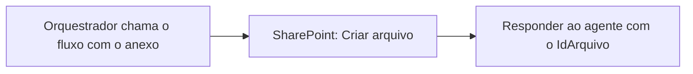

# Fluxo "Salvar Anexo para Analise"

Ferramenta do **orquestrador**. Os agentes conectados não recebem os anexos do Teams, só o texto que o orquestrador envia. Por isso o orquestrador salva cada anexo no SharePoint e repassa apenas o `IdArquivo` ao especialista.

## Gatilho: "Quando um agente chama o fluxo de trabalho"

| Entrada | Tipo | Descrição |
|---|---|---|
| `Arquivo` | File | PDF anexado pelo usuário na conversa (apólice, minuta, endosso, contrato ou aditivo) |

## Ações

| # | Conector / ação | Parâmetros |
|---|---|---|
| 1 | SharePoint – **Criar arquivo** | Site: `<SEU_SITE>` · Pasta: `<SUA_BIBLIOTECA>/<SUA_PASTA>` · Nome: `@concat(formatDateTime(utcNow(),'yyyyMMdd_HHmmss'),'_',triggerOutputs()?['body/file/name'])` · Conteúdo: `@base64ToBinary(triggerOutputs()?['body/file/contentBytes'])` |
| 2 | **Responder ao agente** | Saída `IdArquivo` (Texto) = `Id` da ação 1 |

## Observações

- O prefixo de data e hora evita conflito quando o mesmo arquivo é enviado duas vezes.
- `base64ToBinary` é obrigatório: sem ele o PDF é gravado como texto base64 e fica corrompido.
- Descrição da ferramenta no orquestrador: `Salva no SharePoint um arquivo PDF anexado pelo usuário e retorna o IdArquivo. Use uma vez para cada anexo, antes de acionar o especialista.`
- Autenticação: conta do usuário final. Quem usa o agente precisa ter acesso à pasta.
